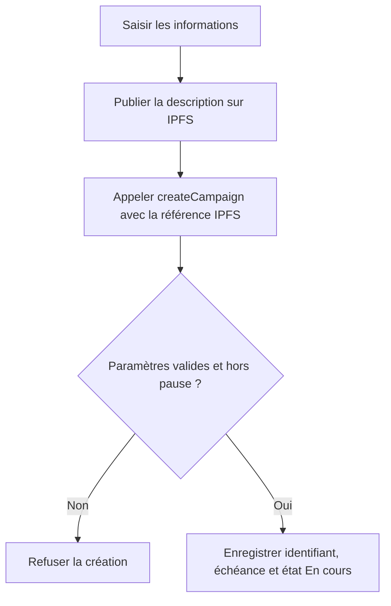
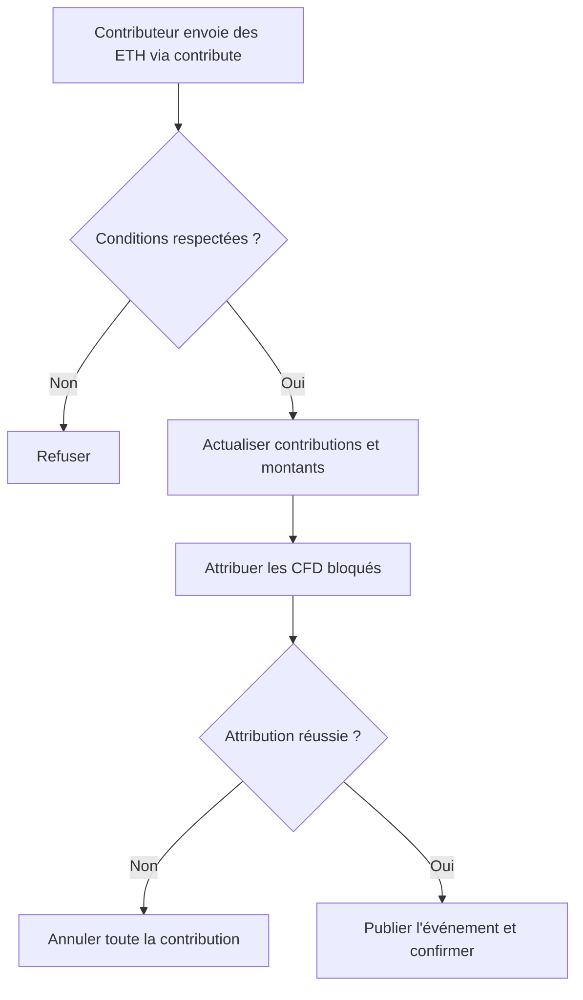
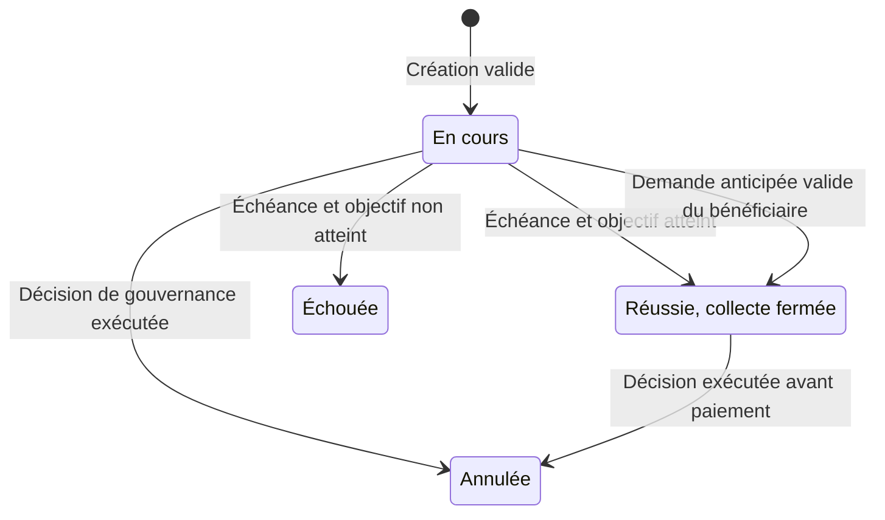
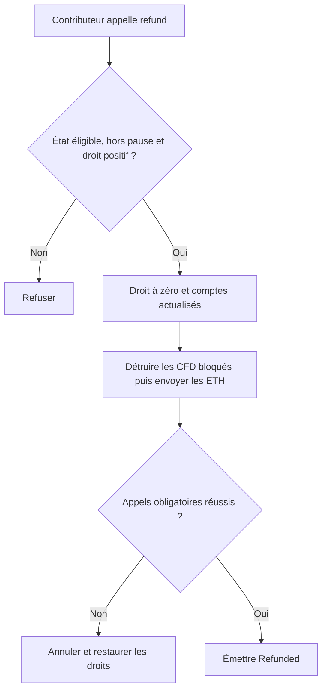
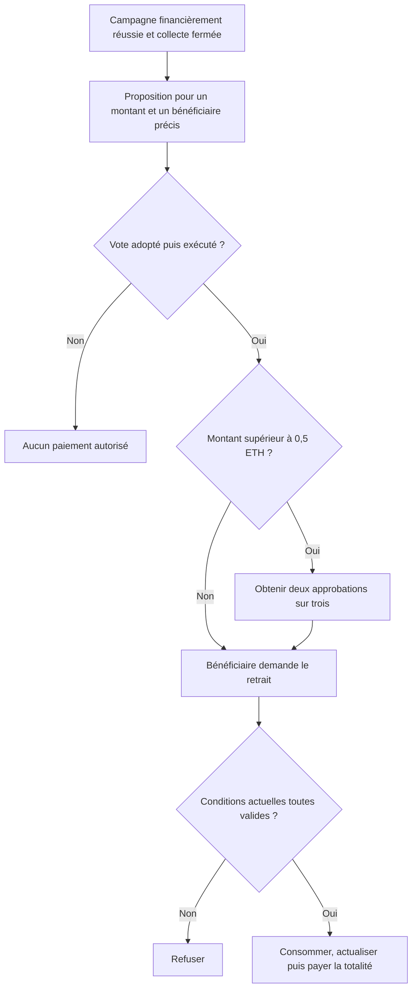
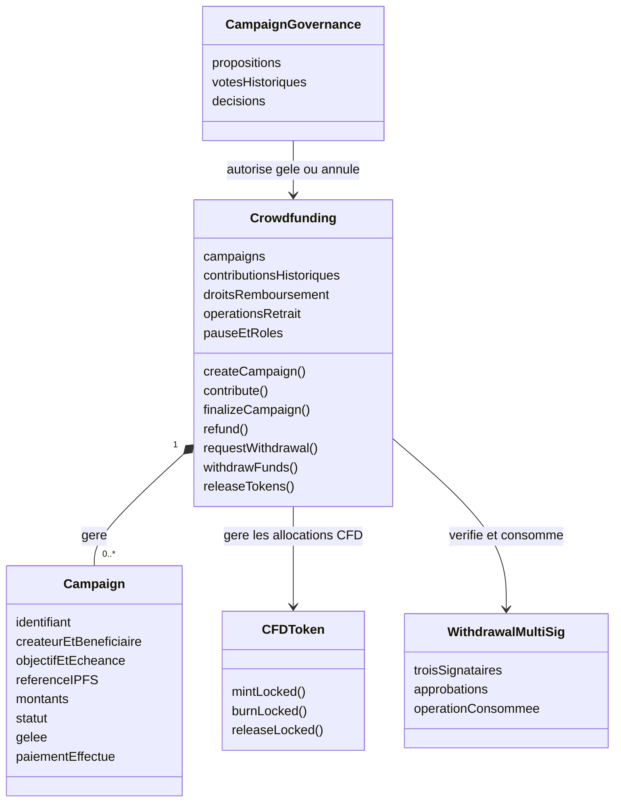

# Jour 1 — Comprendre les campagnes et concevoir Crowdfunding

**Projet :** plateforme de financement participatif décentralisée à gouvernance CFD.    
**Livrable :** description des règles et schéma du contrat `Crowdfunding`.  

> **Notre objectif aujourd'hui :** savoir expliquer ce qui se passe lorsqu'une campagne est créée, financée, réussie, échouée, remboursée ou payée. Nous préparons le fonctionnement du contrat avant de le programmer.


## 1. Le projet en une minute

Notre plateforme permet de financer des projets avec des ETH. Les fonds sont reçus par le contrat `Crowdfunding`, et non immédiatement par le bénéficiaire.

Les contributeurs reçoivent des jetons CFD. Ils permettent de voter selon les règles du contrat de gouvernance. Le bénéficiaire peut recevoir les fonds seulement après les autorisations requises. Si la campagne échoue, les contributeurs peuvent demander leur remboursement.

**Important :** une collecte réussie signifie que l'objectif financier est atteint. Cela ne prouve pas que le projet réel sera réalisé. Après un paiement au bénéficiaire, notre contrat ne peut pas reprendre automatiquement les ETH.

### Ce qui est demandé et ce que nous avons choisi

| Demandé dans le sujet | Choix de notre équipe pour le réaliser |
|---|---|
| Créer des campagnes avec objectif, durée et bénéficiaire | Paramètres fixés à la création et non modifiables ensuite |
| Contribuer en ETH et recevoir des CFD | Taux de 1 ETH pour 1 000 CFD |
| États En cours, Réussie, Échouée et Annulée | Réussite normale évaluée à l'échéance |
| Remboursement si l'objectif n'est pas atteint | Demande individuelle, sans double paiement |
| Retrait par le bénéficiaire après gouvernance | Un seul retrait de tous les fonds disponibles |
| Déblocage anticipé sous gouvernance | Uniquement après atteinte de l'objectif |
| Gel par gouvernance et pause d'urgence Admin | Gel d'une campagne ; pause des opérations financières de la plateforme |
| Multisignature 2-sur-3 au-delà d'un seuil | Seuil fixé à 0,5 ETH pour les retraits bénéficiaires |
| Métadonnées IPFS | Description sur IPFS, référence dans le contrat |
| Protections, tests, fuzzing et audit | À réaliser ensuite, à partir des règles de ce document |


## 2. Qui intervient ?

| Acteur | Son rôle dans notre plateforme |
|---|---|
| **Créateur** | Enregistre la campagne et ses paramètres. |
| **Bénéficiaire** | Adresse qui pourra recevoir le paiement autorisé. Peut être le créateur ou une autre adresse. |
| **Contributeur** | Verse des ETH dans une campagne et possède un droit au remboursement si celle-ci devient éligible. |
| **Participant à la gouvernance** | Vote avec son poids CFD historique pour la proposition. |
| **Administrateur d'urgence** | Peut mettre en pause et reprendre les opérations prévues. Il ne décide pas seul d'un retrait. |
| **Trois signataires** | Deux doivent approuver les retraits dépassant le seuil, en plus du vote. |


## 3. Création d'une campagne

### Informations à fournir

- **Objectif :** montant recherché.
- **Durée :** période de collecte.
- **Bénéficiaire :** adresse destinataire du futur paiement.
- **Référence IPFS :** lien vers le titre, la description et l'image éventuelle.

### Règles retenues

1. L'objectif est strictement positif.
2. Le bénéficiaire n'est pas l'adresse nulle, c'est-à-dire l'adresse composée uniquement de zéros.
3. La durée respecte les bornes configurées : 1 à 90 jours sur Sepolia ; durées courtes pour la démonstration locale.
4. La référence IPFS est renseignée.
5. La plateforme n'est pas en pause.
6. Le contrat crée un identifiant unique et initialise les montants à zéro.
7. Le statut initial est **En cours** et la campagne n'est pas gelée.

**Pourquoi ce choix ?** Des paramètres valides évitent une campagne inutilisable. Leur non-modification protège les conditions auxquelles les contributeurs ont accepté de participer. Les durées courtes locales permettent de tester sans attendre des jours.

### Échéance : ce que nous calculons

La **durée** est une période. L'**échéance** est l'instant où cette période se termine.

```text
échéance = timestamp du bloc de création + durée en secondes
7 jours = 7 × 24 × 60 × 60 = 604 800 secondes
```

Nous acceptons une contribution si l'instant du bloc est **strictement avant** l'échéance. À l'échéance et après, la collecte normale est fermée.


### Schéma de création



Le site récupère le JSON IPFS pour afficher la description. Le contrat ne télécharge pas les fichiers ; il conserve leur référence et les données financières. Un CID IPFS ne prouve pas que la description est vraie.

## 4. Contribution à une campagne

Le contributeur appelle `contribute(campaignId)` en envoyant des ETH.

### Conditions

- La campagne existe et est En cours.
- L'échéance n'est pas atteinte.
- La campagne n'est pas gelée et la plateforme n'est pas en pause.
- Le montant envoyé est strictement positif.

### Ce que le contrat enregistre

1. Le montant est ajouté à l'historique du contributeur.
2. Son droit comptable au remboursement est augmenté.
3. Le total collecté et les fonds disponibles augmentent.
4. Le contrat CFD attribue les jetons correspondants.
5. Un événement de contribution est publié.

Le droit enregistré n'est **pas immédiatement exerçable** : le remboursement nécessite ensuite un échec ou une annulation.

Nous autorisons plusieurs versements par compte et acceptons le dépassement de l'objectif. L'intégralité de la contribution est prise en compte.

**Pourquoi ce choix ?** L'addition des versements et leur acceptation complète simplifient la comptabilité : pas de remboursement partiel automatique du « surplus » pendant une contribution.

### CFD : règle liée à notre conception complète

- Les CFD sont attribués immédiatement et donnent un poids de vote selon le snapshot.
- Ils sont bloqués en transfert tant que les fonds peuvent encore être remboursés.
- Un remboursement détruit les CFD bloqués correspondants.
- Après le paiement final au bénéficiaire, les CFD peuvent être libérés et transférés.

**Pourquoi ce choix ?** Éviter de récupérer ses ETH tout en conservant définitivement les CFD associés, ou de transférer ces CFD avant leur destruction. Ce traitement relève du contrat CFD ; Crowdfunding déclenche les appels nécessaires. Les anciens snapshots ne sont pas réécrits après destruction des jetons.

La contribution et l'attribution doivent réussir ensemble. Si l'attribution obligatoire échoue, la transaction entière doit être annulée.

### Schéma de contribution



## 5. Réussite et échec

### Fonctionnement normal à l'échéance

| Comparaison | État retenu | Suite |
|---|---|---|
| Total collecté supérieur ou égal à l'objectif | **Réussie** | Le bénéficiaire peut demander une autorisation de retrait. |
| Total collecté inférieur à l'objectif | **Échouée** | Les contributeurs peuvent demander leur remboursement. |

**Pourquoi ce choix ?** Respecter la promesse de financement : si le minimum recherché n'est pas atteint, les fonds ne sont pas versés au bénéficiaire.

Atteindre l'objectif avant l'échéance ne ferme pas immédiatement la collecte normale. Une demande anticipée du bénéficiaire peut la fermer, sous les conditions de la section 8.

Le temps ne lance pas une transaction tout seul. Nous prévoyons `finalizeCampaign(id)`, appelable par tout compte après l'échéance. Les opérations doivent vérifier l'état réel avant d'agir, même si personne n'a encore appelé cette finalisation.

### Schéma des états



**Réussie ne veut pas dire payée.** Une information séparée, `fundsWithdrawn`, indique si le retrait final a été effectué.

## 6. Échec, annulation, gel et pause

| Notion | Qui ou quoi la déclenche ? | Effet dans notre projet | Justification |
|---|---|---|---|
| **Échec** | Objectif non atteint à l'échéance | Collecte fermée, retrait refusé, remboursements ouverts | Appliquer la condition financière annoncée |
| **Annulation** | Décision de gouvernance avant paiement | Fin définitive, retrait invalidé, remboursements ouverts | Permettre l'abandon d'une campagne sans payer le bénéficiaire |
| **Gel** | Décision de gouvernance | Contributions et retrait bloqués pour une campagne | Protéger ses fonds pendant une vérification |
| **Pause** | Administrateur d'urgence | Créations, contributions, remboursements et retraits suspendus | Limiter l'exploitation d'une faille technique globale |

Le gel et la pause ne suppriment pas les fonds. Le gel seul n'ouvre pas les remboursements. Une campagne gelée qui échoue à son échéance peut être remboursée hors pause.

**Les échéances continuent à s'écouler** pendant le gel et la pause. Les consultations et les votes restent possibles. Un dégel ne rouvre pas une collecte déjà terminée.

L'Admin n'autorise pas les paiements. La pause ne corrige pas une faille et ne récupère pas des fonds déjà perdus.

## 7. Remboursement des contributeurs

### Conditions et déroulement

Le contributeur appelle `refund(campaignId)`. Il ne choisit ni un destinataire différent ni un montant libre.

1. Vérifier que la campagne est Échouée ou Annulée.
2. Vérifier l'absence de pause et un droit restant positif.
3. Lire son montant et mettre son droit à zéro.
4. Réduire les fonds disponibles et augmenter le total remboursé.
5. Détruire ses CFD bloqués associés à cette campagne.
6. Envoyer les ETH au contributeur.
7. Si un appel obligatoire échoue, annuler l'opération entière.
8. Publier l'événement de remboursement après succès.

**Pourquoi mettre le droit à zéro avant le transfert ?** Le destinataire peut être un contrat qui tente un nouvel appel pendant la réception. Nous supprimons le droit avant cet appel externe et ajoutons une protection anti-réentrance pour éviter le double paiement.

**Pourquoi un remboursement individuel ?** Nous n'avons pas besoin de parcourir tous les contributeurs dans une seule transaction. Chaque compte réclame son montant, ce qui évite une grande boucle coûteuse ou bloquée par un seul destinataire.

**Pourquoi annuler toute l'opération si le transfert échoue ?** Le contributeur doit conserver son droit si aucun paiement n'a été réalisé. Le contrat ne doit pas laisser un droit supprimé sans remboursement.

### Schéma de remboursement



Le remboursement couvre la contribution, pas les frais de gas de l'utilisateur.

## 8. Retrait des fonds par le bénéficiaire

### Règle principale

**Le bénéficiaire peut recevoir tous les fonds disponibles en un seul retrait**, après autorisation. Le seuil ne limite pas la somme reçue.

| Montant du retrait | Autorisations nécessaires |
|---|---|
| Inférieur ou égal à 0,5 ETH | Gouvernance favorable et exécutée |
| Strictement supérieur à 0,5 ETH | Gouvernance favorable et exécutée, puis deux approbations distinctes sur trois |

**Pourquoi ce seuil ?** Le sujet impose une protection multisignature au-delà d'un seuil choisi par l'équipe. Nous ajoutons un contrôle aux montants les plus élevés du prototype sans imposer les transactions supplémentaires à chaque petit paiement.

**Pourquoi un seul retrait ?** Simplifier les comptes et éviter de diviser un paiement en petits retraits pour contourner le seuil. Cela n'empêche pas à lui seul une stratégie de création de plusieurs campagnes.

### Retrait normal

1. La campagne est finalisée Réussie après l'échéance.
2. Le bénéficiaire demande le retrait de tout le montant disponible.
3. La gouvernance vote sur cette opération précise.
4. Une proposition adoptée est exécutée pour enregistrer l'autorisation.
5. Deux signataires approuvent si le seuil l'exige.
6. Le bénéficiaire appelle `withdrawFunds(operationId)`.
7. Le contrat revérifie l'état, la pause, le gel, le montant et toutes les autorisations.
8. Il consomme les droits, actualise les comptes puis transfère les ETH.
9. Après succès, le disponible est nul et le paiement final est enregistré.

Chaque autorisation identifie la campagne, le bénéficiaire, le montant et une opération unique. Une annulation rend le retrait impossible ; un gel bloque le paiement même après un vote favorable.

### Retrait anticipé : avant la date de fin, mais pas sous l'objectif

Nous l'autorisons seulement si :

- le bénéficiaire fait la demande avant l'échéance ;
- l'objectif est déjà atteint ;
- la campagne est En cours, non gelée et la plateforme hors pause ;
- les autorisations de gouvernance et de multisignature sont ensuite obtenues.

**La demande ferme définitivement la collecte**, marque la campagne Réussie et fixe le montant soumis au vote. Elle n'envoie pas immédiatement les ETH. Si le vote est rejeté, les fonds restent dans le contrat ; une nouvelle proposition ou une annulation par gouvernance reste possible.

**Pourquoi fermer avant le vote ?** Pour empêcher le montant de changer entre la proposition, les signatures et le retrait.

**Pourquoi interdire un retrait sous l'objectif ?** Si la campagne échoue ensuite, il pourrait ne plus rester assez pour rembourser. Nous ne devons jamais payer au bénéficiaire des fonds encore nécessaires à une promesse de remboursement.

### Schéma du retrait



L'exécution d'un vote nécessite une transaction : le contrat ne se réveille pas seul à la fin du délai. Les mécanismes de vote et de snapshot seront détaillés par le responsable de la gouvernance ; cette étude définit les conditions attendues par Crowdfunding.

## 9. Les informations à conserver dans Crowdfunding

### Données d'une campagne

| Information | Nom conceptuel | Pourquoi la conserver ? |
|---|---|---|
| Identifiant | `id` | Retrouver la campagne |
| Créateur | `creator` | Tracer sa création |
| Bénéficiaire | `beneficiary` | Contrôler le destinataire du paiement |
| Objectif | `goalWei` | Déterminer réussite ou échec |
| Création et échéance | `createdAt`, `deadline` | Vérifier les dates |
| Référence IPFS | `metadataURI` | Retrouver la présentation |
| Total collecté | `totalRaisedWei` | Garder l'historique financier |
| Fonds disponibles | `availableFundsWei` | Limiter les sorties au montant restant |
| Total remboursé | `totalRefundedWei` | Suivre les retours aux contributeurs |
| Total payé au bénéficiaire | `totalWithdrawnWei` | Suivre le paiement final |
| État | `status` | En cours, Réussie, Échouée ou Annulée |
| Gel | `frozen` | Bloquer cette campagne selon les règles |
| Paiement final effectué | `fundsWithdrawn` | Empêcher une deuxième sortie bénéficiaire |

Les montants ETH sont des entiers en **wei** : `1 ETH = 10^18 wei`. Le site affiche les ETH et effectue les conversions. Le wei n'est pas une monnaie supplémentaire : il évite les calculs décimaux approximatifs pour les montants du contrat.

### Données associées

```text
campagne + adresse → contribution historique
campagne + adresse → droit au remboursement restant
identifiant d'opération → paramètres et autorisation du retrait
plateforme → pause, rôles et adresses des contrats partenaires
```

### Pourquoi distinguer les montants ?

Une campagne ayant reçu 0,6 ETH et remboursé 0,2 ETH possède :

```text
Total historiquement collecté : 0,6 ETH
Total remboursé : 0,2 ETH
Fonds disponibles : 0,4 ETH
```

L'historique n'est pas le solde restant. Nous vérifions :

```text
fonds disponibles = total collecté - total remboursé - total retiré
```

**Pourquoi séparer aussi les campagnes ?** Plusieurs campagnes peuvent partager le même contrat. Son solde global ne donne pas à chaque bénéficiaire le droit de retirer les fonds des autres.

## 10. Schéma du contrat Crowdfunding

Ce schéma représente les responsabilités et données, pas un code Solidity déjà compilable.



### Fonctions à préparer avec l'équipe

| Fonction conceptuelle | Qui appelle ? | Effet principal |
|---|---|---|
| `createCampaign(...)` | Créateur | Enregistrer la campagne |
| `contribute(id)` | Contributeur | Recevoir les ETH et attribuer les CFD |
| `finalizeCampaign(id)` | Tout compte après échéance | Fixer réussite ou échec |
| `refund(id)` | Contributeur éligible | Rembourser son droit |
| `requestWithdrawal(id, reasonURI)` | Bénéficiaire | Préparer la proposition, fermer si demande anticipée valide |
| `withdrawFunds(operationId)` | Bénéficiaire | Exécuter le paiement autorisé |
| `releaseTokens(id, account)` | Tout compte après paiement final | Libérer les CFD du compte désigné |
| `getCampaign(id)` | Tout lecteur | Consulter les données |
| `getContribution(id, account)` | Tout lecteur | Consulter historique et droit restant |
| `authorizeWithdrawal(...)` | Gouvernance seulement | Appliquer une autorisation adoptée |
| `freezeCampaign(id)` / `unfreezeCampaign(id)` | Gouvernance seulement | Appliquer le gel ou le dégel |
| `cancelCampaign(id)` | Gouvernance seulement | Annuler avant paiement selon les règles |
| `pause()` / `unpause()` | Admin seulement | Suspendre ou reprendre les opérations prévues |

**Pourquoi fixer les fonctions ensemble ?** Le contrat CFD, la gouvernance et le site doivent utiliser les mêmes paramètres et unités. Avant de coder, l'équipe fixe aussi les types Solidity exacts et les retours dans des interfaces communes.

### Fonction et événement : ne pas confondre

- Une **fonction** effectue une action ou lit les données : `contribute(id)`.
- Un **événement** trace une opération réussie : `Contributed(...)`.

Prévoir notamment `CampaignCreated`, `Contributed`, `CampaignFinalized`, `Refunded`, `WithdrawalAuthorized`, `FundsWithdrawn`, `CampaignFrozen` et `CampaignCancelled`.

**Pourquoi les deux ?** Les fonctions appliquent les règles ; les événements aident le site et l'équipe à consulter l'historique. Un événement ne transfère pas l'argent et ne remplace pas la comptabilité contractuelle.

## 11. Scénarios à transmettre à la personne qui réalise les tests

Les cases ci-dessous sont à cocher après réalisation des tests, pas simplement après lecture.

- [ ] Création valide : données correctement enregistrées.
- [ ] Objectif nul, bénéficiaire nul ou durée invalide : refus.
- [ ] Contribution positive : comptabilité et CFD corrects.
- [ ] Deux versements du même compte : montants cumulés.
- [ ] Contribution après échéance, sous gel ou en pause : refus.
- [ ] Échec de frappe CFD : aucune contribution partielle conservée.
- [ ] À l'échéance : réussite si objectif atteint, échec sinon.
- [ ] Remboursement d'un compte éligible : montant exact et CFD correspondants détruits.
- [ ] Deuxième remboursement : refus.
- [ ] Échec du transfert : droit conservé grâce à l'annulation globale.
- [ ] Retrait par un non-bénéficiaire ou sans vote valide : refus.
- [ ] Au-dessus du seuil : une approbation insuffisante, deux distinctes nécessaires.
- [ ] Au seuil exact : pas de multisignature supplémentaire exigée par notre règle.
- [ ] Retrait valide : totalité payée une fois, disponible à zéro.
- [ ] Gel ou annulation après autorisation : retrait bloqué selon l'état actuel.
- [ ] Retrait anticipé sous l'objectif : refus.
- [ ] Demande anticipée valide : collecte fermée avant le vote, pas de paiement immédiat.
- [ ] Opérations sur deux campagnes : aucune utilisation des fonds de l'autre.
- [ ] Tentative de réentrance : aucun paiement supplémentaire indu.
